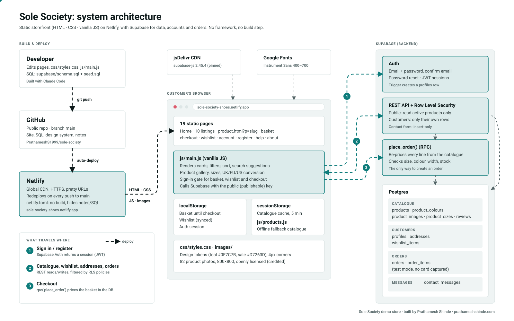

# Sole Society: portfolio kit

Everything for the portfolio entry: links, a short write-up, the animated
architecture diagram and screenshots.

## Links

| What | Link |
|---|---|
| Live store | https://sole-society-shoes.netlify.app |
| Boots listing (filters, sort) | https://sole-society-shoes.netlify.app/boots |
| Product page example | https://sole-society-shoes.netlify.app/product.html?p=burren-leather-chelsea-boot |
| Sale | https://sole-society-shoes.netlify.app/sale |
| Create an account | https://sole-society-shoes.netlify.app/register |
| Help (delivery, returns, size guide, FAQ) | https://sole-society-shoes.netlify.app/help |
| About, privacy and photo credits | https://sole-society-shoes.netlify.app/about#photo-credits |
| Source code (GitHub) | https://github.com/PrathameshS1999/sole-society |
| Your site | https://prathameshshinde.com |

The GitHub repository is public, so the code link works for anyone.

## Short description (for the portfolio card)

> **Sole Society**: a family shoe store built as a static site (HTML, CSS and
> vanilla JavaScript, no framework or build step) with a Supabase backend.
> Customers can browse and filter 23 styles, view multi-photo product pages with
> UK/EU/US size conversion, keep a wishlist, register and sign in, and check out
> in test mode. Hosted on Netlify with continuous deployment from GitHub.

## What it does

- **Storefront:** home page, 10 listing pages with live filters (department, size, price,
  brand, colour, type, width), sort, filter chips and search suggestions.
- **Product page:** one data-driven page renders every product: photo gallery,
  colour switching, stock-aware sizes, size conversion, sample reviews.
- **Accounts:** Supabase Auth with email confirmation and password reset; sign-in
  is required for the basket, wishlist and checkout.
- **Orders:** checkout calls a Postgres function, `place_order()`, that re-prices
  every line from the database, so prices can't be changed in the browser.
- **Security:** Row Level Security on every table: the public key can read active
  products only; customers see only their own addresses, wishlist and orders.
- **Resilience:** catalogue cached for 5 minutes; if the database is unreachable
  the site falls back to a bundled copy of the catalogue.
- **Accessibility:** labelled forms, keyboard-usable search suggestions and basket
  drawer (focus trapped, Escape to close), AA colour contrast, responsive down to 375px.

## Tech stack

HTML · CSS (design tokens) · vanilla JavaScript · Supabase (Postgres, Auth,
REST, RPC, Row Level Security) · supabase-js 2.45.4 via jsDelivr · Netlify ·
GitHub · Google Fonts (Instrument Sans).

## Architecture diagram

- `architecture.svg`: animated (data dots travel along the connections). 14 KB.
- `architecture.png`: still version, 3200×2000, for sites that don't accept SVG
  (LinkedIn, Behance covers, slides).

Embed the animated version on a web page. The animation plays inside a normal
`` tag, and pauses for visitors who ask their system for reduced motion:

```html

```

## Screenshots (`screenshots/`)

Desktop shots are 1440px wide at 2× (2880px files); phone shots are 390px wide at 3×.

| File | Shows |
|---|---|
| `01-home-desktop.jpg` | Home: banner, category tiles, Top rated / On sale / New in (full page) |
| `02-listing-boots-desktop.jpg` | Boots listing with filters and sort (full page) |
| `03-product-desktop.jpg` | Burren leather Chelsea boot: gallery, sizes, conversion, reviews (full page) |
| `04-search-suggestions-desktop.jpg` | Search suggestions while typing "chel" |
| `05-basket-drawer-desktop.jpg` | Basket drawer over a product page, free delivery reached |
| `06-basket-page-desktop.jpg` | Full basket page |
| `07-wishlist-desktop.jpg` | Wishlist with four saved styles |
| `08-sign-in-desktop.jpg` | Sign-in prompt shown when a guest tries to add to the basket |
| `09-register-desktop.jpg` | Create an account |
| `10-home-mobile.jpg` | Home on a phone (full page) |
| `11-product-mobile.jpg` | Product page on a phone (full page) |
| `12-listing-mobile.jpg` | Boots listing on a phone |
| `13-basket-drawer-mobile.jpg` | Basket drawer on a phone |

## Notes for the write-up

- Products, brands and reviews are demo data. Reviews are labelled "Sample review" on the site.
- Product photos are openly licensed (CC BY / BY-SA / CC0 / public domain) and credited on the
  About page. They show other makers' shoes, so say so if you describe the photography.
- Checkout runs in test mode: no card details are collected and no real orders are taken.
